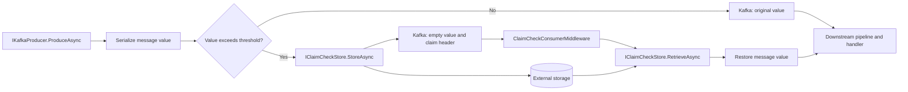

# The Claim-Check Pattern with MinimalKafka

Large messages increase Kafka broker storage, replication traffic, and memory use, and can exceed configured message-size limits. The **claim-check pattern** stores a payload outside Kafka and sends a small identifier that consumers use to retrieve it.

MinimalKafka implements this with producer and consumer middleware registered through `WithClaimCheck()` and the pluggable `IClaimCheckStore` abstraction. It operates on the **entire serialized message value**, not individual file properties. No special file record or JSON converter is required.

Values strictly larger than the configured threshold are stored externally. Kafka receives an empty byte-array value and a header containing the claim identifier. The consumer middleware restores the bytes before the downstream consumer pipeline and handler run.

## Diagram



## Registration

Register claim-check middleware on the `IMinimalKafkaBuilder`:

```csharp
using MinimalKafka;
using MinimalKafka.Serialization;

builder.Services.AddMinimalKafka(config =>
{
    config
        .WithConfiguration(builder.Configuration.GetSection("Kafka"))
        .WithJsonSerializer()
        .WithClaimCheck(options =>
        {
            options.ThresholdBytes = 256 * 1024;
            options.DeleteAfterConsume = false;
        });
});
```

Call `WithClaimCheck()` before registering other middleware so consumers resolve the claim before other middleware reads the value. Enable it on both producing and consuming applications, using the same header name and shared storage.

### Options

`ClaimCheckOptions` is in `MinimalKafka.Middleware.ClaimCheck`.

| Option | Default | Behavior |
| --- | --- | --- |
| `ThresholdBytes` | `256 * 1024` (256 KiB) | Offloads values strictly larger than this byte count. Values at or below it are unchanged. |
| `HeaderName` | `"x-claim-check"` | Kafka header carrying the UTF-8 claim identifier. |
| `DeleteAfterConsume` | `false` | Deletes the stored payload after the downstream consumer pipeline returns successfully. |
| `FileStorePath` | `null` | Directory for the default file-system store; `null` uses `Path.Combine(Path.GetTempPath(), "kafka-claim-check")`. |

Options validation requires a non-negative threshold and a nonblank header name. A threshold of zero offloads every nonempty value.

The threshold applies to value bytes at the producer middleware, not the original file size or the total Kafka record size. For example, JSON serialization encodes a `byte[]` as Base64, increasing its size. Keys and other headers are not offloaded.

## IClaimCheckStore

Implement this interface from `MinimalKafka.Middleware.ClaimCheck` to use another storage backend:

```csharp
public interface IClaimCheckStore
{
    Task<string> StoreAsync(byte[] payload, CancellationToken cancellationToken);
    Task<byte[]?> RetrieveAsync(string claimId, CancellationToken cancellationToken);
    Task DeleteAsync(string claimId, CancellationToken cancellationToken);
}
```

`StoreAsync` returns an opaque identifier. `RetrieveAsync` returns the stored bytes, or `null` when the claim is missing. `DeleteAsync` removes the payload. All three operations accept a cancellation token.

Register a custom `IClaimCheckStore` **before** calling `WithClaimCheck()`. The middleware registration uses `TryAddSingleton`, preserving an existing store registration.

### Default: file-system storage

When no custom store is registered, `WithClaimCheck()` adds `FileSystemClaimCheckStore` as a singleton. This is a real store, not a no-op implementation.

- Creates the configured directory when the store is constructed.
- Generates claim identifiers with `Guid.NewGuid().ToString("N")`.
- Writes to a temporary file, then moves it to `<claimId>.claim`.
- Returns `null` when a claim file is missing.
- Accepts only GUID identifiers in `N` format to prevent path traversal.

The default temporary directory is useful for development. Separate hosts or containers must use storage that they can all access, such as a shared volume or a blob store. A local temporary directory is not shared automatically.

### Example: Azure Blob Storage

The [Examples application](../examples/Examples/Infrastructure/ClaimCheck/AzureBlobClaimCheckStore.cs) implements `AzureBlobClaimCheckStore`. It stores the complete serialized payload as a blob, using an optional prefix followed by `<claimId>.claim`.

The implementation creates the container on store, uploads without overwriting, returns `null` for retrieval failures with HTTP status 404, and uses `DeleteIfExistsAsync` for deletion. It validates claim identifiers as GUIDs in `N` format.

The example's `AddClaimCheckStorage` extension selects a store from configuration:

```csharp
using Examples.Infrastructure.ClaimCheck;
using MinimalKafka;
using MinimalKafka.Serialization;

builder.Services.AddClaimCheckStorage(builder.Configuration);

builder.Services.AddMinimalKafka(config =>
{
    config
        .WithConfiguration(builder.Configuration.GetSection("Kafka"))
        .WithJsonSerializer()
        .WithClaimCheck();
});
```

For local Azure Blob emulation with Azurite, the storage configuration can be:

```json
{
  "ClaimCheck": {
    "Storage": {
      "Provider": "AzureBlob",
      "AzureBlob": {
        "ConnectionString": "UseDevelopmentStorage=true",
        "ContainerName": "minimal-kafka-claim-check",
        "BlobPrefix": "examples"
      }
    }
  }
}
```

`Provider` defaults to `FileSystem`; selecting it leaves registration of the default store to `WithClaimCheck()`. Selecting `AzureBlob` registers `AzureBlobClaimCheckStore`. The Azure options require a connection string and a nonblank container name; the options class defaults the container name to `"claim-check"`.

`AddClaimCheckStorage`, `ClaimCheckStorageOptions`, and the Azure implementation belong to the example application, not the core library. This configuration section selects the example's storage provider; it does not bind `ClaimCheckOptions`. Configure threshold, header, deletion, and file path through `WithClaimCheck(options => ...)` or the .NET options system. Keep production credentials outside committed configuration.

## Producing files

Use an ordinary message containing file metadata and bytes. The current [upload example](../examples/Examples/Features/ClaimCheck/UploadFile.cs) uses topic `"upload-file"` and this request type:

```csharp
public sealed record Request(Guid Identifier, string FileName, string ContentType, byte[] Content);
```

The upload handler copies each form file into memory and sends one request with its identifier as the Kafka key:

```csharp
public static async Task<IResult> Handle(
    [FromServices] IKafkaProducer producer,
    [FromForm] IFormFileCollection files,
    CancellationToken cancellationToken)
{
    foreach (var file in files)
    {
        await using var stream = new MemoryStream();
        await file.CopyToAsync(stream, cancellationToken);

        var request = new Request(
            Guid.NewGuid(),
            file.FileName,
            file.ContentType,
            stream.ToArray());

        await producer.ProduceAsync("upload-file", request.Identifier, request, cancellationToken: cancellationToken);
    }

    return TypedResults.Accepted("/");
}
```

The handler uses `Microsoft.AspNetCore.Mvc` and `MinimalKafka.Producing`. In the example it is mapped to `POST /claim-check/`.

On `ProduceAsync`:

1. The producer serializes the value before invoking middleware. Raw `byte[]` values are used directly; strings are UTF-8 encoded.
2. `ClaimCheckProducerMiddleware` passes values at or below `ThresholdBytes` through unchanged.
3. For larger values, it awaits `StoreAsync`, removes any existing header with the configured name, and adds the UTF-8 claim identifier.
4. It replaces the value with an empty byte array and invokes the remaining producer pipeline to publish.
5. If that downstream call throws, it attempts to delete the stored payload using `CancellationToken.None` and propagates the failure.

File metadata is part of the stored serialized value, not a separate JSON claim-check envelope in Kafka. Nested objects and collections are supported to the extent that the configured serializer supports them; the middleware does not reflect over file properties.

## Consuming files

Map the consumer normally:

```csharp
app.MapTopic(UploadFile.Topic, UploadFile.Consumer);
```

`ClaimCheckConsumerMiddleware` looks for the last header matching `HeaderName`:

1. Without a matching header value, it invokes the downstream pipeline unchanged.
2. With a claim header, it decodes the identifier and retrieves the payload.
3. A missing payload (`null`) causes an `InvalidOperationException`; the handler is not called.
4. It replaces `KafkaContext.Value` with the retrieved bytes, then invokes the downstream pipeline. Typed `[FromValue]` handlers deserialize the restored message normally.
5. If `DeleteAfterConsume` is enabled, it deletes the payload after the downstream pipeline returns successfully.

The example's `UploadFile.Consumer` receives a `Request` with populated `Content`. It records metadata and the content length in an in-memory queue, keeping at most 50 responses. `GET /claim-check/` lists those responses; it is not a file download endpoint and does not retain the file bytes in that queue.

## Direct storage access

Outside the middleware pipeline, resolve `IClaimCheckStore` and call `StoreAsync`, `RetrieveAsync`, or `DeleteAsync` directly. Retrieval returns the complete stored value bytes, not a file object. If the producer used JSON, those bytes contain the whole JSON message and must be deserialized before accessing its file content.

The store-generated claim identifier is independent of the upload request's `Identifier` and Kafka key. Use the claim header to identify the stored payload; do not assume the request identifier is the storage key.

## Benefits

- **Smaller Kafka values**: large payloads are replaced by a claim header and an empty value.
- **Transparent handlers**: consumers receive their normal message types after the value is restored.
- **Serializer-independent middleware**: claim checks operate on bytes rather than a specific file record.
- **Pluggable storage**: implement one interface for a shared file system, blob storage, or another backend.

## Use Cases

- Document and media ingestion pipelines.
- EDI / batch file transfer between systems.
- Image or report generation workflows.
- Any event whose serialized value is large enough to justify external storage.

## Things to keep in mind

- **Retention and replay**: Kafka retention and storage retention are independent. Keep payloads available for every consumer group and replay window. `DeleteAfterConsume` defaults to `false`; there is no automatic retention cleanup in the default store.
- **Deletion is not offset-atomic**: optional deletion occurs before the background service commits the Kafka offset. A crash or commit failure after deletion can leave a redelivered message referencing missing data. Deletion also prevents other consumer groups from retrieving the same claim.
- **Pipeline success**: deletion depends on the downstream pipeline returning normally. Middleware that handles an error without rethrowing can therefore allow deletion even if the original handler failed.
- **Missing payloads fail consumption**: missing claims throw rather than producing empty file content. Storage failures and deletion failures propagate as well.
- **Publication and storage are not transactional**: storage completes before publishing, and downstream producer failures trigger a cleanup attempt. Crashes, failed cleanup, or ambiguous delivery outcomes still require operational recovery and cleanup policies.
- **Memory**: serialization, storage, and retrieval use complete byte arrays. This pattern reduces Kafka payload size but does not provide streaming or eliminate application memory costs.
- **Broker limits still apply**: keys, headers, and records must still fit configured limits. Select a threshold appropriate for the complete record, not just its value.
- **Security**: validate claim identifiers in custom stores and authorize access to external storage. Treat the claim header as reserved for middleware, not an application-supplied file path or an authorization secret.
