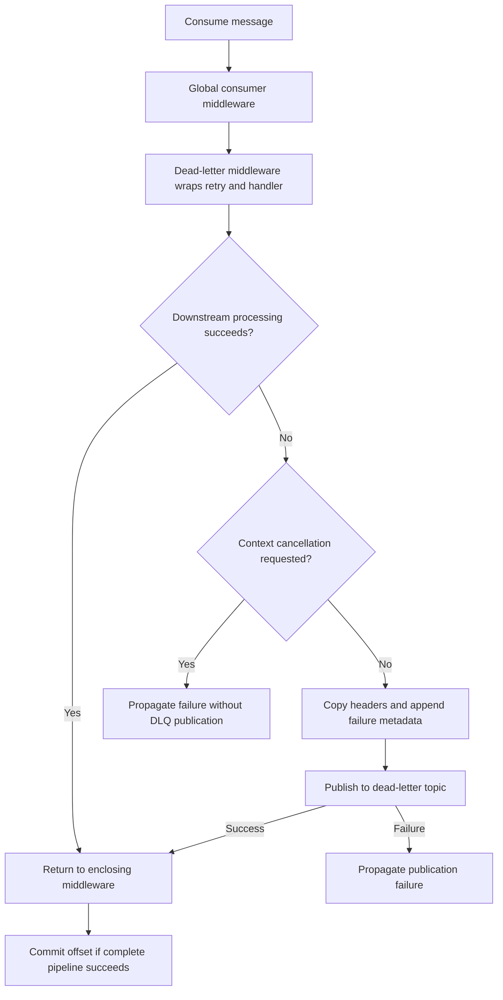

# Dead-Letter Queues in MinimalKafka

A dead-letter queue (DLQ) is a Kafka topic used to isolate messages whose processing failed. MinimalKafka's `WithDeadLetter()` middleware catches downstream consumer exceptions, attempts to publish a record to a dead-letter topic, and returns successfully if publication succeeds. The consumer can then move on once its enclosing pipeline and offset commit succeed.

This is an opt-in, per-topic policy. For retry settings, filtering, and cancellation, see [Resilience](resilience.md).

> **Current implementation limitation:** Dead-letter publishing currently passes the consumed value as the producer key and the consumed key as the producer value. Do not assume a DLQ record has the original key/value layout, or replay it unchanged. See [Current implementation limitations](#current-implementation-limitations).

## Register the policy

Import `MinimalKafka.Middleware.Resilience` and add `WithDeadLetter()` to a mapped topic. The following mapping deliberately returns a failed task so the policy can be observed:

```csharp
using MinimalKafka;
using MinimalKafka.Middleware.Resilience;

app.MapTopic("retry", (KafkaContext context) =>
	Task.FromException(new InvalidOperationException($"Cannot process {context.Topic}.")))
	.WithDeadLetter()
	.WithRetry();
```

This assumes MinimalKafka services are registered and `app` has been built; see the [complete resilience setup](resilience.md#quick-start).

Register dead-letter routing **before** retry middleware. The first registration wraps the second, so the retry policy gets a chance to succeed before the final failure reaches the DLQ policy. A failure excluded by `ShouldRetry` reaches the DLQ immediately.

For dead-letter routing without retries, omit `.WithRetry()`. There is no automatic replay, retention configuration, topic provisioning, or DLQ consumer registration.

## Destination topic

The API is `WithDeadLetter(string? deadLetterTopic = null)`. Without an explicit destination, it constructs the destination from `TopicBuilder.Topic + "-dlq"`.

With no naming convention transformations, a source mapped as `"retry"` uses `"retry-dlq"`. To choose a destination explicitly, use this alternative mapping:

```csharp
app.MapTopic("retry", (KafkaContext context) =>
	Task.FromException(new InvalidOperationException($"Cannot process {context.Topic}.")))
	.WithDeadLetter("failed-messages")
	.WithRetry();
```

The destination is passed through the normal producer, including its topic naming convention and global producer middleware.

### Naming convention caveat

`MapTopic` applies the naming convention before creating the `TopicBuilder`. The default DLQ name therefore already includes the mapped source name, and the producer applies the convention again to the constructed destination.

For example, with a suffix of `"-development"`, mapping `"retry"` gives a builder topic of `"retry-development"`. The default DLQ string becomes `"retry-development-dlq"`, which the producer transforms into `"retry-development-dlq-development"`.

An explicit logical destination such as `"retry-dlq"` avoids deriving the name from an already transformed source; the producer still transforms it once. Verify the actual destination with your naming rules. Ensure it is a different physical topic from the source, and provision appropriate retention, permissions, and capacity. MinimalKafka does not prevent routing loops.

## Processing flow



When a downstream exception is caught and the context token is not canceled, the middleware:

1. Logs the exception, original topic, partition, offset, and DLQ destination at Error level.
2. Copies the current message headers into a new `Headers` collection.
3. Appends the diagnostic headers listed below.
4. Awaits `KafkaContext.Producer.ProduceAsync` with the destination, message bytes, copied headers, and context cancellation token.
5. Returns without rethrowing the original processing exception if publication succeeds.

If publication fails, its exception escapes. With `.WithDeadLetter().WithRetry()`, publication is outside the retry middleware, so `WithRetry` does not retry that send.

The cancellation filter checks the context token, not the exception's type. An `OperationCanceledException` can still be dead-lettered if that token has not been canceled. If cancellation is already requested when processing fails, the original failure propagates without dead-letter publication.

## Diagnostic headers

Existing headers are preserved and these headers are appended as UTF-8 bytes:

| Header | Value |
| --- | --- |
| `x-original-topic` | `KafkaContext.Topic`, the physical topic being consumed. |
| `x-original-partition` | Source partition number represented as text. |
| `x-original-offset` | Source offset represented as text. |
| `x-exception-type` | Full exception type name, or its simple name when no full name is available. |
| `x-exception-message` | Exception message truncated to at most 1,024 .NET string characters. |

The message-length limit is a character limit, not a UTF-8 byte limit. The middleware does not add the stack trace, retry count, failure timestamp, or consumer group as headers.

Headers with these names are not replaced or deduplicated. Repeated dead-letter routing can therefore accumulate multiple entries. Use the last occurrence when interpreting the metadata for the most recent routing attempt; older entries may describe an earlier failure.

Exception metadata describes the exception caught by the middleware. Synchronous handler exceptions can be wrapped in `TargetInvocationException` by the handler adapter, so the stored type and message may describe that wrapper rather than its inner exception.

Exception messages and copied application headers may contain sensitive information. Apply appropriate topic ACLs and retention policies; exception-message truncation is not sanitization.

## Current implementation limitations

The current [DeadLetterMiddleware](../src/MinimalKafka/Middleware/Resilience/DeadLetterMiddleware.cs) calls a producer whose argument order is `(topic, key, value, ...)`, but supplies `(deadLetterTopic, context.Value ?? [], context.Key, ...)`.

Before any global producer middleware changes the record, this means:

| DLQ field | Current source |
| --- | --- |
| Key | Current `KafkaContext.Value`, or an empty byte array if it is null. |
| Value | Original `KafkaContext.Key`. |
| Headers | Copied current headers plus diagnostic headers. |

Consequences:

- **Key and value are swapped.** A normal typed value consumer on the DLQ will not receive the original serialized value in the expected field.
- **Keyless source records fail DLQ publication.** A null original key is passed as the producer value; the current producer rejects null values. The failure escapes and the source message does not reach the explicit commit call.
- **The current context is used.** Earlier middleware may have modified `KafkaContext.Value`, so the forwarded bytes are not necessarily the original Kafka wire value. For example, claim-check middleware may already have restored a large payload.
- **Producer middleware still runs.** It can further transform the DLQ record; do not infer the final wire layout solely from the call above.

These are current behavior limitations, not a recommended message format. Verify or correct this path before relying on DLQ records for production recovery. This guide does not provide a replay snippet that assumes original key/value preservation.

## Offsets and delivery guarantees

MinimalKafka disables automatic offset commits and automatic offset storage. The background service explicitly commits a consumed result only after the complete consumer pipeline returns successfully.

A successful DLQ send handles the original processing failure, allowing that commit to be attempted. A failed DLQ send propagates; the current message does not reach that explicit commit call. An unhandled non-cancellation exception is logged as critical and rethrown by the background service, which closes the consumer. The host's background-service exception configuration determines the wider application response.

Publishing a DLQ record and committing the source offset are **not transactional**. A crash or commit failure after publication can cause source redelivery and duplicate DLQ records. Recovery consumers should use source metadata and application identifiers to make processing idempotent. The headers do not include a source consumer group, so add application-level context if distinct processing workflows must be distinguished.

A log saying that a message is being sent to the DLQ is emitted before publication; it is not confirmation of delivery. Monitor publication failures and source consumer health as well as DLQ backlog.

## Policy boundaries

The dead-letter middleware catches only exceptions from the downstream delegate it invokes. It does not cover:

- Global middleware failures before entering, or after leaving, the topic pipeline.
- Earlier per-topic middleware failures outside its downstream delegate.
- Middleware construction or service-resolution failures while assembling the pipeline.
- Kafka subscription, `Consume`, or `Commit` failures in the background service.

Failures during parameter binding or deserialization inside the downstream handler adapter are eligible for routing. However, a policy cannot route a record that was never successfully delivered to its invocation.

## Claim-check interactions

[Claim-check middleware](claims-check-pattern.md) is global and resolves a claim before entering the per-topic pipeline. Consequently:

- A missing claim or storage retrieval failure is outside topic-level dead-letter and retry protection.
- Dead-letter routing sees the restored payload and copies the existing claim header.
- With the current key/value swap, restored payload bytes become the DLQ key. Claim-check producer middleware measures only the value, so it does not offload a large DLQ key; the record can exceed broker limits.
- If `DeleteAfterConsume` is enabled, a successfully handled DLQ failure can cause the outer claim-check middleware to delete the stored payload. A copied claim header may then reference missing data.

Do not assume that enabling both policies makes DLQ storage or replay safe automatically. Verify the actual record layout, preserve external payloads for the recovery window, and define how recovery handles claim headers. Keeping `DeleteAfterConsume = false` avoids immediate deletion, but it does not fix the swapped fields or replace a retention policy.

## Operating a DLQ

A DLQ isolates failures; it does not repair or replay them automatically. A recovery workflow should:

1. Inspect error metadata, application logs, and current record layout without assuming normal value deserialization.
2. Fix the cause of failure, such as invalid input, missing dependencies, or incompatible schemas.
3. Confirm that any referenced external payload remains available.
4. Decide whether to discard, repair, or reprocess the message under an explicit policy.
5. Republish only after reconstructing the expected source key, value, format, and appropriate headers for the deployed implementation.
6. Record the recovery outcome and prevent duplicate side effects or repeated routing loops.

Provision and monitor DLQ topics independently from source topics. Choose retention long enough for investigation, restrict access to sensitive payloads and exception messages, and alert when recovery backlog grows. There is no built-in DLQ browser, automatic reprocessor, delayed retry topic, or exactly-once recovery guarantee.
